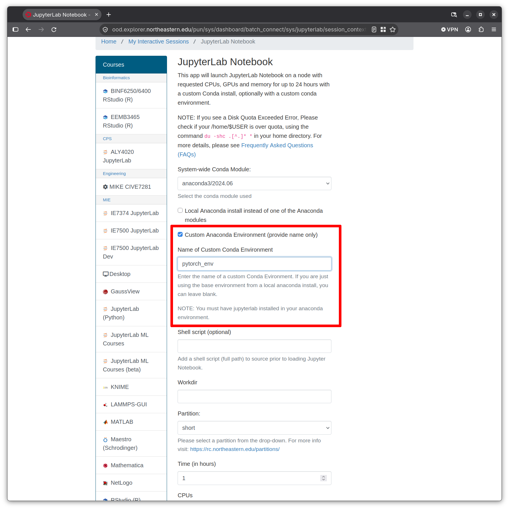

# Research Computing Training

## Presenter

Ghanghoon "Will" Paik

HPC Performance Engineer

[Research Computing](https://rc.northeastern.edu/research-computing-team/)

## Running PyTorch Training Jobs on Explorer

Welcome to the [Research Computing Fall 2026 Training Series](https://rc.northeastern.edu/research-computing-fall-training/)!

In this session, we will get PyTorch working on Explorer, either with conda or with a shared container, and turn a Python training script into a batch job. On the way, we will talk about picking a GPU, how to use a conda environment or a container for PyTorch training, and how to keep your training inside the time limit of the GPU partition.

Today's Agenda:

[1. Choosing a GPU on Explorer](#1-choosing-a-gpu-on-explorer)  
[2. Matching PyTorch to the GPU](#2-matching-pytorch-to-the-gpu)  
[3. Option A: Installing PyTorch with Conda](#3-option-a-installing-pytorch-with-conda)  
[4. Option B: Using the PyTorch Container](#4-option-b-using-the-pytorch-container)  
[5. Interactive Development with Jupyter on OOD](#5-interactive-development-with-jupyter-on-ood)  
[6. From Notebook to Batch Job](#6-from-notebook-to-batch-job)  
[7. Summary and Resources](#7-summary-and-resources)  

Sample code used in this session is available at **[Running-PyTorch-Training-Jobs-2026](https://github.com/northeastern-rc-training/Running-PyTorch-Training-Jobs-2026)**

It has `train.py` (ResNet-18 on CIFAR-10), `download_data.py`, the batch scripts for downloading and training (conda and container versions), and the container definition file.

---

## 1. Choosing a GPU on Explorer

### 1.1 GPUs in the `gpu` Partition

These are the GPUs you can get in the public `gpu` partition:

| GPU | `--gres` name | Memory | Architecture (compute capability) | Native BF16 | Availability |
|---|---|---|---|---|---|
| T4 | `t4` | 16 GB | Turing (7.5) | No | Few |
| V100 PCIe | `v100-pcie` | 32 GB | Volta (7.0) | No | Many |
| V100 SXM2 | `v100-sxm2` | 32 GB | Volta (7.0) | No | Many |
| A100 | `a100` | 40/80 GB | Ampere (8.0) | Yes | Few |
| H200 | `h200` | 141 GB | Hopper (9.0) | Yes | Few |

You can request a specific GPU type with `--gres`:

```bash
#SBATCH --partition=gpu
#SBATCH --gres=gpu:v100-sxm2:1
```

If you don't care about the type, `--gres=gpu:1` gives you whichever GPU frees up first.

`sinfo` shows what is in the partition and how many nodes are in each state:

```bash
sinfo -p gpu -o "%25G %10t %5D"
```

Sample output:

```
GRES                      STATE      NODES
gpu:v100-pcie:2(S:0-7)    down*      1    
gpu:v100-sxm2:4(S:0-1)    comp       4    
gpu:h200:8                comp       1    
gpu:v100-pcie:2(S:0-1)    mix        3    
gpu:v100-sxm2:4(S:0-1)    mix        5    
gpu:v100-sxm2:3(S:0-1)    mix        1    
gpu:t4:4(S:0-1)           mix        1    
gpu:a100:3                mix        1    
gpu:a100:4                mix        2    
gpu:h200:8                mix        3    
gpu:v100-sxm2:4(S:0-1)    alloc      2    
gpu:v100-sxm2:3           alloc      1  
```

### 1.2 What Uses GPU Memory

GPU memory fills up with four things during training: the model weights, the gradients (one per weight), the optimizer state, and the activations that the forward pass saves for the backward pass. An optimizer like SGD with momentum keeps one extra copy of the weights and Adam keeps two. Activations are the part that grows when you increase the batch size.

For a rough number, FP32 training with Adam takes about 16 bytes per parameter before you even count activations. So, if a model uses 1 billion parameters, it requires around 16 GB just to get started.

If GPU memory runs out, PyTorch stops with an error like:

```
torch.OutOfMemoryError: CUDA out of memory. Tried to allocate ...
```

If that happens, you can try the following:

1. Lower the batch size.
2. Switch to a GPU with more memory (A100 40/80 GB or H200 141 GB).
3. Try memory saving tricks like mixed precision, which is covered in the Optimizing GPU usage session.

### 1.3 Which One Should I Pick?

You may start with a V100 since there are more V100s available on Explorer, so V100 jobs usually start sooner than jobs on other GPU types. T4s are fine for quick tests or small models.

Moving up to an A100 or H200 makes sense if any of these apply:

- your job runs out of memory on a V100 after you lower the batch size
- you need BF16 (many recent models are trained and released in BF16)
- your training won't finish within 8 hours on a V100

A bigger GPU doesn't always mean faster training. With a small model, or with a GPU that spends half its time waiting for data, an H200 won't help you much. Check how busy your GPU actually was with `gpu-logs` ([Section 6.6](#66-after-the-job-check-how-it-went)) before moving up.

### 1.4 Partition Limits

| Partition | Max time | GPUs per job | Access |
|---|---|---|---|
| `gpu` | 8 hours | 1 | All users |
| `gpu-interactive` | 2 hours | 1 | All users |
| `multigpu` | 24 hours | 8 | Application and approval required |

We will use `gpu` for the batch jobs in this session and `gpu-interactive` for the OOD examples. If your training needs more than 8 hours, take a look at [Section 6.5](#65-fitting-in-8-hours).

---

## 2. Matching PyTorch to the GPU

PyTorch requires the following to use a GPU:

| Piece | What it is | Who controls it | How to check |
|---|---|---|---|
| NVIDIA driver | Software on the GPU node that talks to the GPU | Research Computing | `nvidia-smi` |
| PyTorch CUDA build | The CUDA version PyTorch was compiled with | You, when you install PyTorch | `torch.version.cuda` |
| GPU architecture | The generation of the GPU | The node your job lands on | `torch.cuda.get_device_capability()` |

In practice, that comes down to two rules:

1. **The driver has to support the CUDA version your PyTorch was built with.** Explorer's drivers support CUDA 12.x, so a CUDA 12.x build works and a CUDA 13.x build does not.
2. **The build has to include code for your GPU.** You can list the architectures in your build with `torch.cuda.get_arch_list()`. For example, a V100 (compute capability 7.0) needs `sm_70` in that list.

Here are the highest CUDA versions that the drivers on Explorer support:

| GPU | Driver supports up to | Compute capability |
|---|---|---|
| V100 (PCIe, SXM2) | CUDA 12.3 | 7.0 (`sm_70`) |
| T4 | CUDA 12.8 | 7.5 (`sm_75`) |
| A100 | CUDA 12.8 | 8.0 (`sm_80`) |
| H200 | CUDA 12.8 | 9.0 (`sm_90`) |

> Driver versions as of October 2026. Run `nvidia-smi` on your node to see the current one.

### 2.1 The Default Install Does Not Work on Explorer

Right now, the `pip install torch` command installs a build made for CUDA 13.0. This is what you get if you install the latest version on a V100:

```
>>> import torch
>>> torch.__version__
'2.14.1+cu130'
>>> torch.cuda.is_available()
.../torch/cuda/__init__.py:228: UserWarning: CUDA initialization: The NVIDIA driver on your system is too old (found version 12030). ...
False
```

(`found version 12030` is the driver telling you it supports up to CUDA 12.3.)

`is_available()` doesn't show you an error. It prints a warning and returns `False`. Many training scripts choose the device like this:

```python
device = "cuda" if torch.cuda.is_available() else "cpu"
```

So, if the wrong build is used, the training script won't crash. It runs on the CPU instead. The sample `train.py` checks for this and stops with an error.

### 2.2 What Works: PyTorch 2.14.1 with CUDA 12.6

```
>>> torch.__version__
'2.14.1+cu126'
>>> torch.version.cuda
'12.6'
>>> torch.cuda.is_available()
True
>>> torch.cuda.get_device_name(0)
'Tesla V100-SXM2-32GB'
>>> torch.cuda.get_arch_list()
['sm_50', 'sm_60', 'sm_70', 'sm_75', 'sm_80', 'sm_86', 'sm_90']
```

This build covers every GPU architecture on Explorer (tested on a V100). It also runs fine on the CUDA 12.3 driver of the V100 nodes, since a CUDA 12 driver can run builds made with a newer CUDA 12 release.

> Note: PyTorch 2.14 is the last release that ships CUDA 12 builds. From 2.15 on, the prebuilt packages need a CUDA 13 driver and drop V100 (`sm_70`) support. For now, stick with PyTorch 2.14 on Explorer.

### 2.3 Do I Need `module load cuda`?

This is a common question, and the answer is "no" for PyTorch training. When the PyTorch package is installed with pip, the CUDA libraries it needs are installed too. The only thing PyTorch takes from the node is the driver.

The CUDA module is only needed when you compile CUDA code yourself.

---

## 3. Option A: Installing PyTorch with Conda

You can use `conda` to create a Python environment and `pip` to install PyTorch into it.

### 3.1 Create the Environment

You need to get an interactive job to create a conda environment and install Python packages. Please do not run it on the login node.

```bash
srun --partition=short --cpus-per-task=4 --mem=8G --pty bash

module load miniconda3/25.9.1
conda create -n pytorch_env python=3.12 -y
source activate pytorch_env
pip install torch==2.14.1 torchvision==0.29.1 \
    --index-url https://download.pytorch.org/whl/cu126
```

The `--index-url` option lets `pip` look only at PyTorch's CUDA 12.6 package index. If you don't use this flag, you get the default build, which is CUDA 13.x. In this tutorial, package versions are fixed for reproducibility.

> Note: The conda environment takes about 6.5 GB. `conda` keeps a cache of downloaded packages in `~/.conda/pkgs`. You can use `conda clean --all` to clear cached files if your home quota gets tight. Also, `pip cache purge` can be used to clear the `pip` cache.

### 3.2 Check It on a GPU Node

Since the login node and CPU nodes don't have GPUs, you need to get a GPU job to verify the installation:

```bash
srun --partition=gpu --gres=gpu:1 --cpus-per-task=2 --mem=8G --time=15:00 --pty bash

module load miniconda3/25.9.1
source activate pytorch_env
python -c "import torch; print(torch.__version__, torch.version.cuda, torch.cuda.is_available())"
```

You should see:

```
2.14.1+cu126 12.6 True
```

### 3.3 Adding More Packages

You can add other packages with `pip` or `conda`. If a package needs a newer PyTorch, `pip` may replace your PyTorch with a version that does not work on Explorer.

Two ways to keep your PyTorch intact:

- Put `torch==2.14.1` in the same `pip` command. Then if a package needs a different version, `pip` will stop with an error instead of swapping it out:

  ```bash
  pip install transformers matplotlib torch==2.14.1
  ```

- After installing anything, you can run the check from Section 3.2 again. `torch.version.cuda` should still say `12.6`.

---

## 4. Option B: Using the PyTorch Container

For this session, we provide an Apptainer image with PyTorch installed. It also has a few other ML packages, so you can keep using it for your own work after the session. The container is stored in a shared location, so it doesn't use your home quota.

Container location: `/shared/container_repository/explorer/pytorch/pytorch_training.sif`

It includes:

- Python 3.12, PyTorch 2.14.1, torchvision
- numpy, pandas, scipy, scikit-learn, matplotlib, seaborn, tqdm
- h5py, pyarrow, zarr
- transformers, accelerate, datasets, safetensors, optuna
- pillow, opencv-python-headless, tensorboard, ipykernel

You can see the list of installed packages with:

```bash
apptainer exec /shared/container_repository/explorer/pytorch/pytorch_training.sif cat /opt/pip-freeze.txt
```

### 4.1 Run Python Inside the Container

```bash
apptainer exec --nv -B /scratch /shared/container_repository/explorer/pytorch/pytorch_training.sif \
    python -c "import torch; print(torch.__version__, torch.cuda.is_available())"
```

A quick look at the options:

- `exec` runs the command you give it inside the container.
- `--nv` makes the GPU and the node's NVIDIA driver visible inside the container.
- `-B` binds directories into the container. Only your home directory is accessible by default, so add `/scratch` or `/projects` if you need access.

### 4.2 Need Another Package?

Please don't `pip install` inside the container. The image is read-only, and you will not be able to install additional packages.

What you can do is copy the definition file from the sample repository (`pytorch_training.def`), add the packages you need, and build your own image. Section 7 of the [Software Installation training](https://github.com/northeastern-rc-training/Intro-to-Software-Installation-2026) walks through it.

### 4.3 Conda or Container?

| | Conda + pip | Shared container |
|---|---|---|
| Setup | You install it yourself | Nothing to install |
| Adding packages | Easy | Rebuild the image |
| Home quota | \~6.5 GB, tens of thousands of files | None, the image lives in a shared location |
| Filesystem load | Many small files read at every import | One file |
| Good for | Development, changing packages often | Standard packages, running the same setup in many jobs |

---

## 5. Interactive Development with Jupyter on OOD

Jupyter is handy for developing and testing your code before submitting a batch job. The JupyterLab Notebook app on OOD can run your own conda environment, as long as `jupyterlab` is installed in it:

```bash
module load miniconda3/25.9.1
source activate pytorch_env
conda install -y jupyterlab
```



1. Open the JupyterLab Notebook app on OOD.
2. Pick the `gpu-interactive` partition and a GPU type.
3. Check **Custom Anaconda Environment (provide name only)** and type `pytorch_env` in **Name of Custom Conda Environment**.
4. Once the session starts, check the GPU in a notebook cell:

   ```python
   import torch
   print(torch.__version__, torch.version.cuda, torch.cuda.is_available())
   ```

5. Run a short training. Type out the full path here, since `$USER` doesn't get expanded inside `%run`:

   ```python
   %run train.py --epochs 2 --data-dir /scratch/<username>/data
   ```

Anything that takes longer than 1 hour should be submitted as a batch job. And when you are done testing, please end the session so the GPU can be used by other users.

> **IdleBot:** Explorer keeps an eye on GPU usage on the public GPU nodes. If your GPU stays under-utilized for 15 minutes, IdleBot starts emailing you warnings, and after 1 hour it cancels the job.

---

## 6. From Notebook to Batch Job

### 6.1 From Notebook to Script

Once you have tested your code in Jupyter, the next step is making a script that can run without you watching it. You can export a notebook to a Python script with:

```bash
jupyter nbconvert --to script my_notebook.ipynb    # creates my_notebook.py
```

The exported script usually needs some cleanup before it runs as a batch job. Notebook-only lines like `%matplotlib inline` or `!pip install` fail, so remove them. Plots won't show up in a batch job, so replace `plt.show()` with `plt.savefig("loss.png")`.

Beyond that, a few changes make a big difference on a cluster. The sample `train.py` has all of them, so you can use it as a template.

**Stop early if there is no GPU.** As Section 2.1 showed, a wrong PyTorch build makes `torch.cuda.is_available()` return `False` without an error. `train.py` checks this first and exits if no GPU is found:

```python
if not torch.cuda.is_available():
    raise SystemExit("ERROR: PyTorch cannot use a GPU. ...")
```

**Take paths and settings as arguments.** Hard-coded paths break if you move the data or run from another directory. With `argparse`, the same script works for a quick test and for a full run:

```python
p.add_argument("--data-dir", default="./data")
p.add_argument("--epochs", type=int, default=10)
```

That is also why the sample batch scripts end with `"$@"`. Running `sbatch train_conda.sh --epochs 3` passes `--epochs 3` straight to `train.py`.

**Match DataLoader workers to the cores you asked for.** `train.py` counts the number of cores assigned to the job and starts one worker fewer than that (Section 6.4 shows why this matters):

```python
num_workers = max(1, len(os.sched_getaffinity(0)) - 1)
```

**Print with `flush=True`.** In a batch job, the output goes to a file, and Python may hold it in a buffer for a long time. Flushing makes the log show progress while the job is running.

**Save checkpoints.** If a run might get close to the time limit, save its state regularly so it can pick up from there when you resubmit it (Section 6.5).

### 6.2 Download Data Before the GPU Job

Downloading a dataset doesn't need a GPU. You can do it in a CPU job and point all your GPU training jobs at that copy.

`download_data.sh`:

```bash
#!/bin/bash
#SBATCH --job-name=download-cifar10
#SBATCH --partition=short
#SBATCH --nodes=1
#SBATCH --ntasks=1
#SBATCH --cpus-per-task=1
#SBATCH --mem=4G
#SBATCH --time=2:00:00
#SBATCH --output=%x-%j.out

DATA_DIR=/scratch/$USER/data

module load miniconda3/25.9.1
source activate pytorch_env
python download_data.py --data-dir "$DATA_DIR"
```

There are two reasons for doing it this way:

1. Downloading a dataset can take a long time.
2. You can keep a single copy of the dataset by downloading it to a fixed path.

`train.py` doesn't download anything. If the data isn't there, it stops instead of holding on to the GPU:

```
ERROR: CIFAR-10 dataset not found in /scratch/<user>/data.
  Please download it first:
  python download_data.py --data-dir /scratch/<user>/data
```

This applies to your own data too, whether it is model weights from Hugging Face, a dataset from the web, or files from another server. Get them in a CPU job or on the transfer node (`xfer.discovery.neu.edu`) first.

### 6.3 The Batch Script

`train_conda.sh`:

```bash
#!/bin/bash
#SBATCH --job-name=pytorch-training
#SBATCH --partition=gpu
#SBATCH --nodes=1
#SBATCH --ntasks=1
#SBATCH --gres=gpu:v100-sxm2:1
#SBATCH --cpus-per-task=4
#SBATCH --mem=16G
#SBATCH --time=30:00
#SBATCH --output=%x-%j.out

DATA_DIR=/scratch/$USER/data

module load miniconda3/25.9.1
source activate pytorch_env

echo "Job $SLURM_JOB_ID on $(hostname)"
nvidia-smi

python train.py --data-dir "$DATA_DIR" --epochs 10 "$@"
```

Here is what each part does:

| Line | What it does |
|---|---|
| `--partition=gpu` | GPU partition: up to 8 hours, 1 GPU |
| `--gres=gpu:v100-sxm2:1` | One V100-SXM2. Use `--gres=gpu:1` for any type |
| `--cpus-per-task=4` | CPU cores for the job. `train.py` uses all but one of them to load data |
| `--mem=16G` | CPU memory (RAM). This is not GPU memory |
| `--time=30:00` | Time limit. Slurm stops the job when it is reached |
| `--output=%x-%j.out` | Log file named after the job name and job ID. Output and errors both go here |
| `module load` and `source activate` | Activate the environment inside the job |
| `nvidia-smi` | Shows which GPU and driver the job got. Useful when you ask for help |
| `"$@"` | Passes extra arguments to `train.py` (e.g., `sbatch train_conda.sh --epochs 3`) |

The container version of the batch script only changes the last part (see `train_container.sh`):

```bash
CONTAINER=/shared/container_repository/explorer/pytorch/pytorch_training.sif

apptainer exec --nv -B /scratch "$CONTAINER" \
    python train.py --data-dir "$DATA_DIR" --epochs 10 "$@"
```

To submit and follow the log:

```bash
sbatch train_conda.sh
squeue -u $USER
tail -f pytorch-training-<jobid>.out
```

### 6.4 How Many CPUs?

While the GPU trains on one batch, DataLoader workers on the CPU are getting the next ones ready: reading the images, cropping and flipping them, and turning them into tensors. `train.py` starts one worker per CPU core and leaves one core for the main process.

Here is the same job on a V100-SXM2 with only `--cpus-per-task` changed (average of epochs 2 and 3):

| `--cpus-per-task` | DataLoader workers | Train time per epoch | Images per second |
|---|---|---|---|
| 1 | 1 | 17.2 s | 2,900 |
| 4 | 3 | 11.2 s | 4,500 |
| 8 | 7 | 11.1 s | 4,500 |

Things to notice:

- With 1 core, each epoch took about 50% longer, because the GPU kept waiting for the CPU. `gpu-logs` ([Section 6.6](#66-after-the-job-check-how-it-went)) shows the same thing from the GPU's side: 96% GPU Utility with 4 cores and about 57% with 1 core.
- Going from 4 to 8 cores made no difference. Once the data shows up fast enough, extra cores don't help.
- If you leave out `--cpus-per-task`, you get the default number of cores, which can be too few for a GPU job. 4 cores per GPU is a good place to start for jobs like this.

If you set more DataLoader workers than you have cores, PyTorch warns you with something like the line below. It usually means `--cpus-per-task` is missing:

```
UserWarning: This DataLoader will create 3 worker processes in total. Our suggested max number of worker in current system is 1, which is smaller than what this DataLoader is going to create. ...
```

The Optimizing GPU usage session goes further into tuning the data pipeline.

### 6.5 Fitting in 8 Hours

Before a long run, try 2 or 3 epochs, look at the job's wall-clock time with `seff` ([Section 6.6](#66-after-the-job-check-how-it-went)), and scale it up with some margin. Use the wall-clock time from `seff` as a baseline. The `Total time` that `train.py` prints at the end only covers the training loop, so starting Python, importing packages, and loading the data are not in it.

When a job hits its time limit, Slurm stops it and the log ends with a line like:

```
slurmstepd: error: *** JOB <jobid> ON <node> CANCELLED AT <time> DUE TO TIME LIMIT ***
```

`train.py` saves `output/checkpoint.pt` after every epoch. So if the job gets stopped, you can submit the same script again and it picks up from the last finished epoch:

```
Resumed from output/checkpoint.pt, starting at epoch 7
```

To start from scratch, delete the output directory. If you run several jobs at the same time, give each one its own `--output-dir`. Otherwise they overwrite each other's checkpoints and resume from the wrong one.

The [Checkpoint Restart on HPC](https://github.com/northeastern-rc-training/Checkpointing-on-HPC) session covers checkpointing in more depth.

### 6.6 After the Job: Check How It Went

Once a job finishes, two commands will tell you whether you asked for the right resources.

`seff` shows how much of the requested CPU time and memory the job actually used. Here is the sample job (60 epochs, 4 cores):

```
Job ID: 11304335
Cluster: explorer
User/Group: g.paik/users
State: COMPLETED (exit code 0)
Nodes: 1
Cores per node: 4
CPU Utilized: 00:26:22
CPU Efficiency: 49.56% of 00:53:12 core-walltime
Job Wall-clock time: 00:13:18
Memory Utilized: 1.18 GB
Memory Efficiency: 7.39% of 16.00 GB
```

`gpu-logs` shows GPU and GPU memory utilization over the life of the job. It works for jobs on the public nodes from the past 7 days, and you run it from an interactive session in the `short` partition:

```bash
srun -p short --constraint=ib --pty bash
gpu-logs <jobid>
```

For the same job:

```
                       GPU Info
                        GPU #2
            Time|    Memory|   GPU Utility|  Activity
=====================================================
2026-10-22T13:06|    2.07 %|          96 %|    active
2026-10-22T13:08|    2.07 %|          96 %|    active
2026-10-22T13:09|    2.07 %|          96 %|    active
2026-10-22T13:11|    2.07 %|          96 %|    active
2026-10-22T13:13|    2.07 %|          96 %|    active
2026-10-22T13:15|    2.07 %|          96 %|    active
```

It only samples every few minutes, so a short job may show just one or two lines.

A few things to look for:

- If **GPU utilization is low**, the GPU was waiting on something. Check `--cpus-per-task` ([Section 6.4](#64-how-many-cpus)) before requesting a bigger GPU.
- **Low CPU efficiency** is normal for a GPU job, because the DataLoader workers need some slack to stay ahead of the GPU. In the sample job, 4 cores at 50% efficiency beat 1 core at 93%. Only cut cores if the run time doesn't change.
- If **memory use is far below `--mem`**, ask for less memory next time. The sample job used 1.2 GB out of 16 GB.
- If **GPU memory use is low**, a smaller GPU may be enough. The sample job used about 2% of the V100's 32 GB.

### 6.7 Putting It Together: Planning a Run

Here is how the pieces fit together for a run of your own. Let's assume that you want to train a model with 300 million parameters using the Adam optimizer.

1. **Pick a GPU:** At 16 bytes per parameter (Section 1.2), the model needs about 5 GB before activations. That leaves plenty of room on a V100 with 32 GB of memory, so you can start there.
2. **Ask for cores and memory:** Start with 4 cores (Section 6.4) and enough `--mem`. You will adjust both after the first run.
3. **Do a short test:** Run a few epochs and check the wall-clock time with `seff`. For this example, let's say it comes out to about 5 minutes per epoch.
4. **Check the time limit:** 100 epochs at 5 minutes each will require more than 8 hours, so the run won't fit in a single job. Since `train.py` saves a checkpoint every epoch, you can resubmit the job and the training will resume.
5. **Check after the first job:** If `gpu-logs` shows low GPU utilization, check your `--cpus-per-task` first. If utilization is already high and the run is still too slow, a faster GPU like an A100 is worth requesting. `seff` tells you whether to adjust `--mem` next time.

---

## 7. Summary and Resources

### Key Takeaways

1. **Use PyTorch 2.14.1 with CUDA 12.6 on Explorer.** The default `pip install torch` may give you a CUDA 13 build, which doesn't work with our current drivers.
2. **Always check on a GPU node.** You want `torch.version.cuda` to say `12.6` and `torch.cuda.is_available()` to return `True`.
3. **Conda or container?** Conda is easier when you change packages often, and the shared container is easier when the standard packages are all you need. Performance is the same.
4. **Download data in a separate CPU job.** A GPU should never sit idle waiting for a download.
5. **Ask for CPU cores too.** With 1 core, each epoch of the sample job took about 50% longer. 4 cores were enough.
6. **Start with a V100.** Switch to an A100 or H200 when you need more memory or BF16, or when a V100 job takes too long.
7. **Plan around the 8-hour limit.** Time a short run first, and checkpoint and resubmit if you need longer.

### Quick Reference

```bash
# Conda environment (in an interactive job)
module load miniconda3/25.9.1
conda create -n pytorch_env python=3.12 -y
source activate pytorch_env
pip install torch==2.14.1 torchvision==0.29.1 --index-url https://download.pytorch.org/whl/cu126

# Check on a GPU node
python -c "import torch; print(torch.__version__, torch.version.cuda, torch.cuda.is_available())"

# Shared container
apptainer exec --nv -B /scratch /shared/container_repository/explorer/pytorch/pytorch_training.sif \
    python train.py --data-dir /scratch/$USER/data
```

### Sample Code Repository

**[Running-PyTorch-Training-Jobs-2026](https://github.com/northeastern-rc-training/Running-PyTorch-Training-Jobs-2026)**

It has `train.py`, `download_data.py`, `download_data.sh`, `train_conda.sh`, `train_container.sh`, and `pytorch_training.def`.

### Getting Help

Email the Research Computing team at [rchelp@northeastern.edu](mailto:rchelp@northeastern.edu).

Come to [office hours](https://rc.northeastern.edu/getting-help/) hosted on Zoom.

Or [book a consultation](https://rc.northeastern.edu/getting-help/) with an RC team member.

Review our [Documentation](https://rc-docs.northeastern.edu/en/latest/index.html).

Thank you!

---

_For questions or support, contact the Research Computing team at [rchelp@northeastern.edu](mailto:rchelp@northeastern.edu)_
